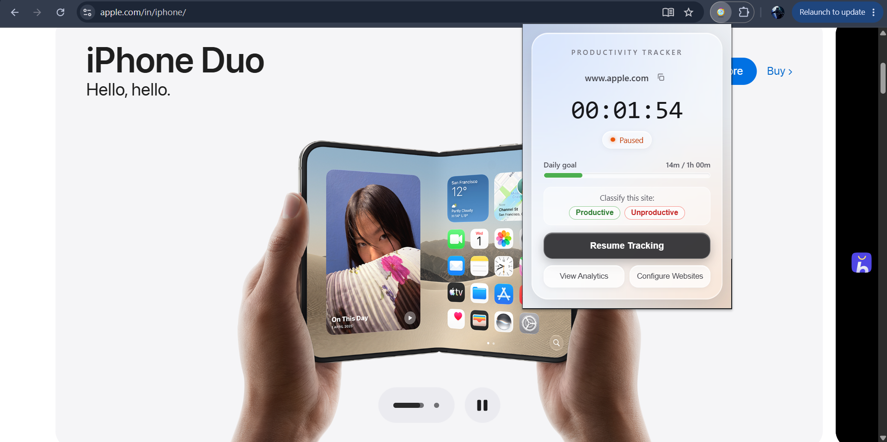
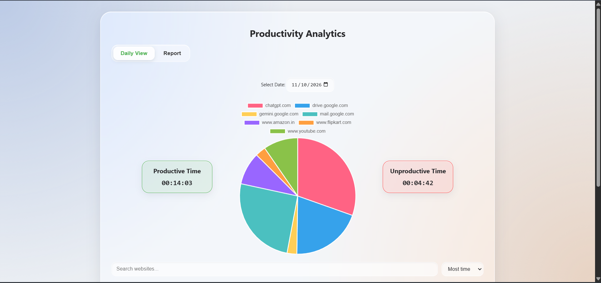
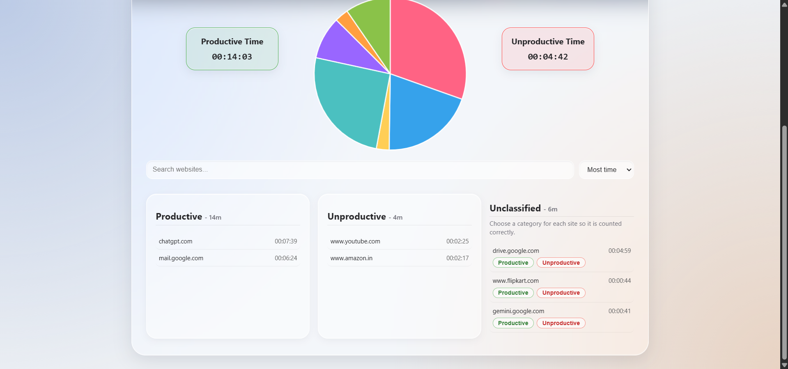
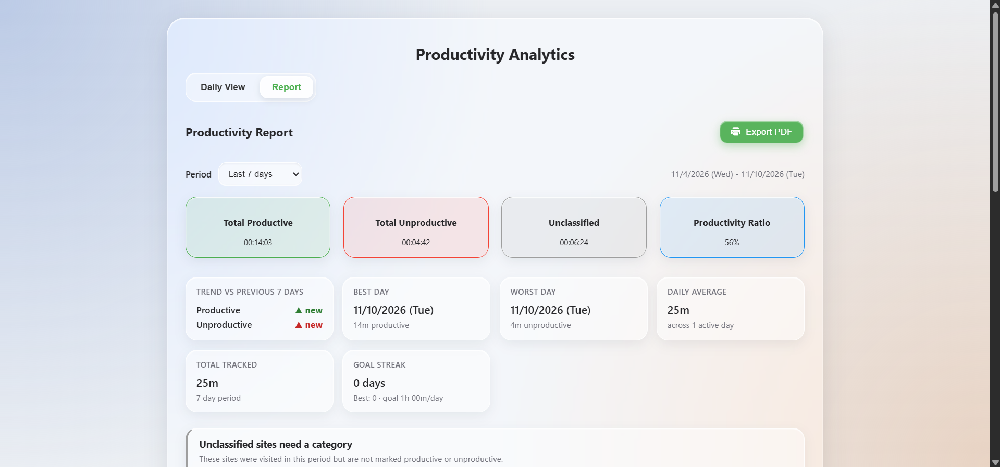
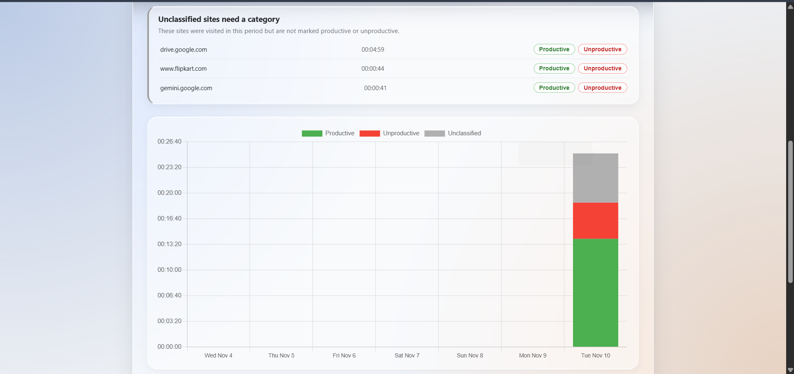
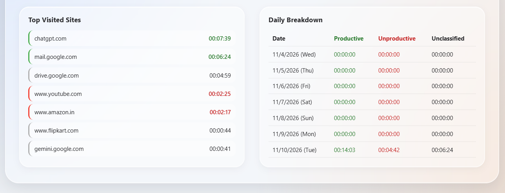
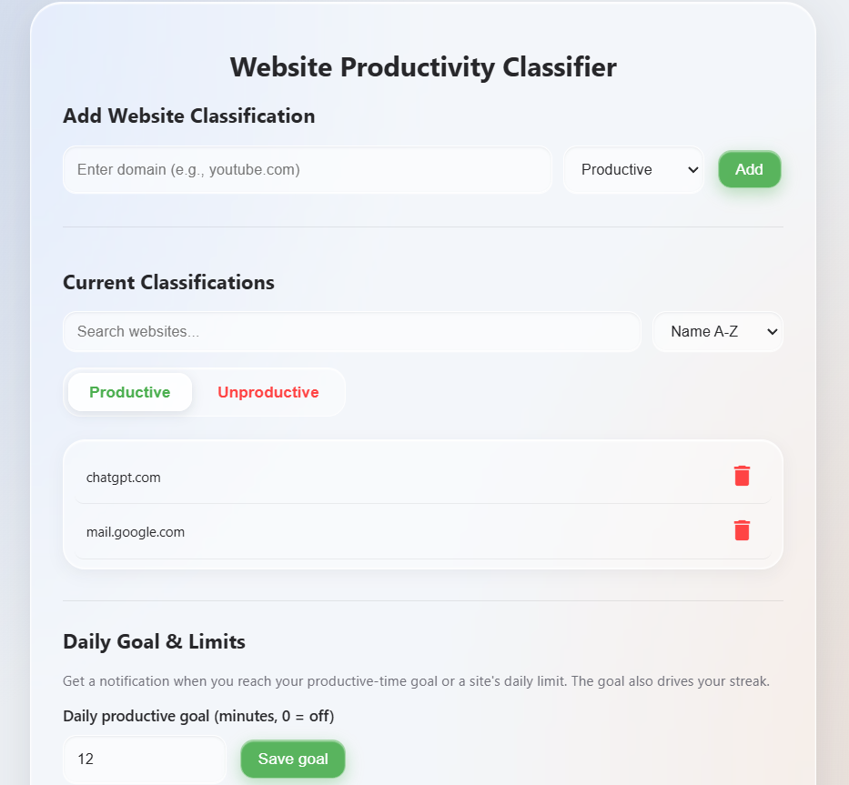
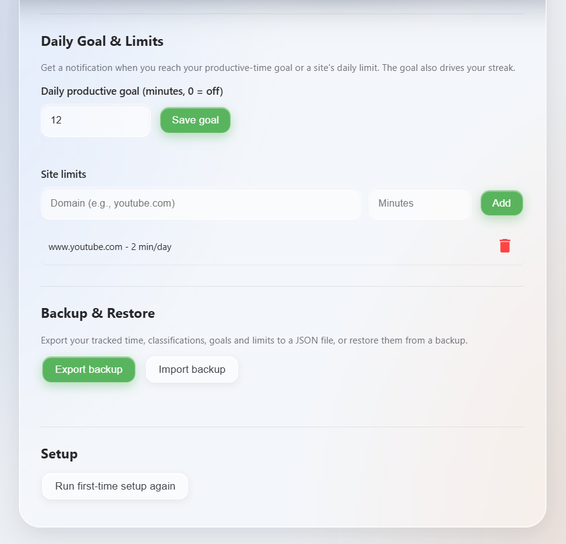

# Productivity Tracker

A privacy-first Chrome extension that tracks how much time you spend on each website, helps you classify sites as productive or unproductive, and turns that data into charts, insights and exportable reports.

All data stays in your browser. There is no server, no account and no network access.


<p align="center">
  
</p>

## Table of contents

- [Features](#features)
- [Screenshots](#screenshots)
- [Installation](#installation)
- [Usage](#usage)
- [How tracking works](#how-tracking-works)
- [Tech stack](#tech-stack)
- [Project structure](#project-structure)
- [Privacy and data storage](#privacy-and-data-storage)
- [Known limitations](#known-limitations)
- [Roadmap](#roadmap)
- [Project information](#project-information)
- [License](#license)

## Features

**Tracking**
- Per-site control: a new website shows **Start Tracking**, then **Pause** / **Resume**.
- Tracks only genuine activity: the tab must be active, the browser window focused and the user not idle. Playing audio or video counts as activity.
- Correct day boundaries: time is recorded against the local date and split at midnight.
- `www.example.com` and `example.com` are treated as one site.

**Popup**
- Current website with a one-click copy button, a live timer and a status indicator (Tracking, Paused, Waiting).
- Daily goal progress bar and the time left on a site limit.
- One-click **Productive** / **Unproductive** buttons for unclassified sites.

**Analytics**
- **Daily view:** pick any date for a pie chart, productive / unproductive totals, and searchable, sortable site lists. Unclassified sites can be categorised in place.
- **Report view:** last 7, 14 or 30 days, this month, or a custom range.
  - Summary cards and productivity ratio
  - Trend versus the previous period
  - Best and worst day, daily average, total tracked time and goal streak
  - Stacked bar chart per day, top 10 sites and a daily breakdown table with weekdays
- **PDF export** of the report.

**Goals and limits**
- Set a daily productive-time goal and per-site daily limits.
- Notifications when a goal or limit is reached (once per day).

**Settings, backup and onboarding**
- Add, search, sort and remove classified websites.
- Export everything to a JSON file and restore it later. Imports are validated and size-limited before any data is replaced.
- A first-run setup page helps new users pick sites and a daily goal.

## Screenshots

### Popup

<p align="center">
  
</p>

### Analytics: daily view

<p align="center">
  
</p>
<p align="center">
  
</p>

### Analytics: report view

<p align="center">
  
</p>
<p align="center">
  
</p>
<p align="center">
  
</p>

### Settings

<p align="center">
  
</p>
<p align="center">
  
</p>

## Installation

The extension is not published on the Chrome Web Store, so load it as an unpacked extension:

1. Download or clone this repository.
2. Open `chrome://extensions` in Chrome.
3. Turn on **Developer mode** (top right).
4. Click **Load unpacked** and select the project folder.
5. Pin the extension to the toolbar. A welcome page opens on first install.

No build step or dependencies to install: all libraries are bundled.

## Usage

1. Open any website and click the extension icon.
2. Press **Start Tracking**. Chrome pauses a site's timer while the popup is open, so close the popup to let it run.
3. Classify the site as **Productive** or **Unproductive** from the popup, the analytics page or Settings.
4. Click **View Analytics** to explore daily and period reports, or **Configure Websites** to manage classifications, goals, limits and backups.

## How tracking works

Manifest V3 background workers can be suspended at any time, so the extension does not rely on in-memory timers. Instead:

1. Tab, window-focus and idle events, plus a 30-second alarm, each trigger a sync.
2. On every sync, the time elapsed since the previous sync is credited to the site that was being tracked, split at local midnight.
3. The extension then re-evaluates what should be tracked now (active tab, focus, idle state, per-site start / pause).
4. If the computer slept or the worker was suspended for more than 90 seconds, that gap is not counted.

A one-shot alarm at local midnight makes sure the day rolls over even if nothing else is happening.

## Tech stack

| Area | Technology |
|---|---|
| Platform | Chrome Extension, Manifest V3, ES-module service worker |
| Languages | Vanilla JavaScript, HTML5, CSS3 (glassmorphism design) |
| Chrome APIs | `tabs`, `windows`, `idle`, `alarms`, `notifications`, `storage`, `runtime` |
| Storage | `chrome.storage.local`, `chrome.storage.sync`, `chrome.storage.session` |
| Charts | [Chart.js](https://www.chartjs.org/) 4.5.0 (bundled) |
| PDF export | [jsPDF](https://github.com/parallax/jsPDF) 4.2.1 (bundled) |
| Security | Strict CSP (`script-src 'self'`), escaped output, validated imports |

There is no backend, framework or build tooling.

## Project structure

```
.
├── manifest.json        Extension configuration and permissions
├── background.js        Tracking engine, alarms, goal and limit notifications
├── common.js            Shared helpers: dates, formatting, classification, goals, storage limits
├── popup.html / .js     Toolbar popup
├── analytics.html / .js Daily view, report view and PDF export
├── options.html / .js   Classifications, goals and limits, backup and restore
├── onboarding.html / .js First-run setup
├── styles.css           Shared styles
├── icons/               Extension icons
├── LICENSE              MIT license
├── lib/                 Bundled Chart.js and jsPDF
└── docs/screenshots/    README images
```

## Privacy and data storage

- **No data leaves your computer.** The extension makes no network requests, and no analytics or external fonts are loaded.
- **Time data and tracking states** are stored in `chrome.storage.local` (with the `unlimitedStorage` permission), inside your Chrome profile on disk.
- **Classifications and goals** are stored in `chrome.storage.sync`, so Chrome can sync them across your signed-in devices. Sync storage has small size limits, and the extension warns you if a list grows too large.
- **Live tracking state** is kept in `chrome.storage.session`.
- Data is **not encrypted**, so anyone with access to your Chrome profile can read it. Use **Export backup** regularly, because uninstalling the extension or losing the profile deletes the data.

Permissions requested: `tabs`, `storage`, `unlimitedStorage`, `alarms`, `idle`, `notifications`.

## Known limitations

- Time history is stored per browser profile and is not synced between devices.
- Data is stored unencrypted and there is no automatic backup.
- All time data is kept in a single storage entry, which is fine for years of normal use but would need a different storage design at a much larger scale.
- Websites are tracked by hostname only (ports and paths are ignored), and local pages without a dot in the hostname, such as `localhost`, are not tracked.

## Roadmap

- Optional cloud sync of tracking history
- Optional encryption of stored data
- Automated tests for the date and midnight-rollover logic

## Project information

Developed as an internship project.

| | |
|---|---|
| **Company** | CODTECH IT Solutions |
| **Name** | Aditya Samson |
| **Intern ID** | CT08DL961 |
| **Domain** | Full Stack Web Development |
| **Batch duration** | May 20th, 2025 to July 20th, 2025 |
| **Mentor** | Neela Santhosh Kumar |

## License

This project is licensed under the [MIT License](LICENSE). The bundled libraries, Chart.js and jsPDF, are also MIT-licensed.
